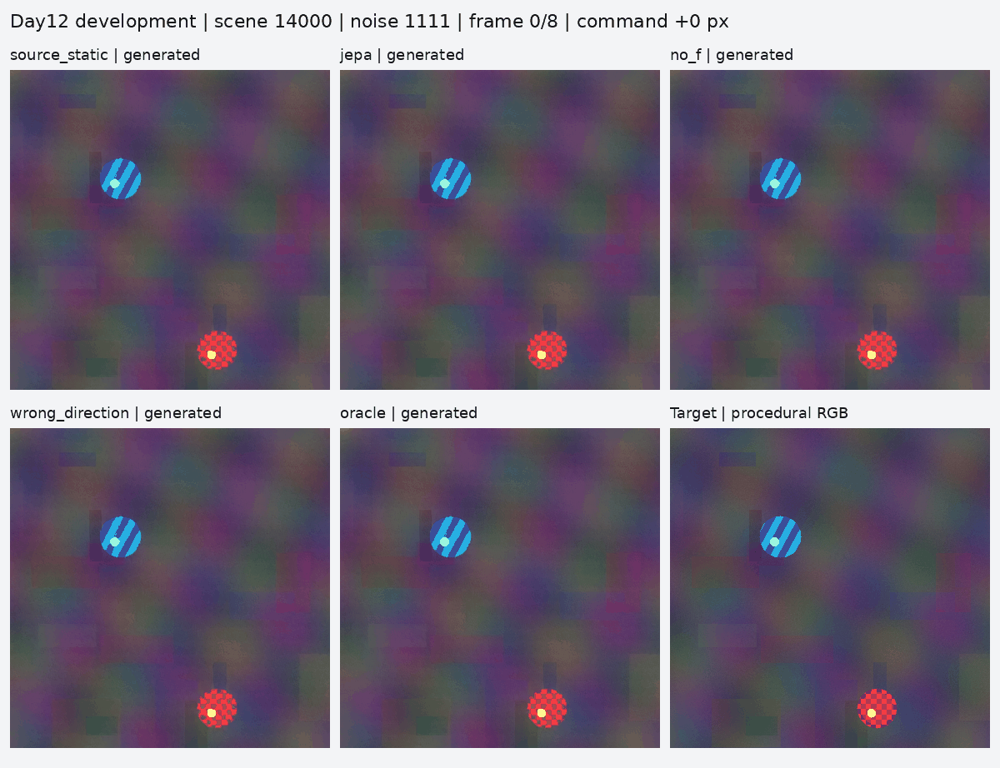

# Day12: JEPA-derived guides through an actual video generator

The complete test ran on Kaggle on 2026-10-10. **The video generator followed the
edited guides, but the learned translator did not beat the matched baseline.**
This is an interface and motion-control result on two procedural development
scenes, not proof that JEPA solves video identity or consistency.

## What was tested

Wan2.1-VACE-1.3B generated 20 clips: two previously inspected scenes × two noise
seeds × five conditions. Each clip has nine frames at 384×384. Fixed settings:
20 denoising steps, CFG 5, conditioning scale 1, FP16 transformer, FP32 video VAE
and initial noise, native PyTorch SDPA. Source checkpoint:
`eeaa0f946317f4313c76063dc17034fc0f1132f2`. Model revision:
`ec4d2cb062b548996b179d493fdd05340de702a1`.

The route was edited JEPA features plus the frozen image translator and source
appearance transport → decoded RGB guide frames → official whole-video VACE
conditioning → joint video denoising and decoding. It was not a newly trained
temporal ControlNet. The full nine-frame guide was supplied. Object selection,
motion trajectory and source correspondences were given by the experiment;
JEPA did not infer a scene plan or physical motion.

| Condition | Meaning |
|---|---|
| `source_static` | Repeat the reconstructed source frame while retaining the motion prompt |
| `jepa` | Edited JEPA route with the learned CNN and source appearance transport |
| `no_f` | Same provenance/appearance transport with the CNN contribution removed |
| `wrong_direction` | Guide motion opposite to intended motion; prompt unchanged |
| `oracle` | Exact procedural target video as guide; privileged control |

`no_f` is a strong matched ablation, not a prompt-only model. Comparing `jepa`
against it isolates the CNN contribution. The task moves one patterned colored
object by up to 64 pixels and back while the other object and background stay fixed.

## Results across all four cases per condition

| Condition | Mean position error, px ↓ | Object texture MSE ↓ | Correct motion steps |
|---|---:|---:|---:|
| Static source | 28.465 | 0.078366 | 0/32; all stationary |
| JEPA + CNN | 1.092 | 0.017564 | 32/32 |
| No CNN (`no_f`) | 0.826 | 0.016670 | 32/32 |
| Wrong direction | 56.418 | 0.089212 | 0/32; all reversed |
| Oracle | 0.859 | 0.017105 | 32/32 |

All 180 generated frames were detected by the procedural color detector.
Position is centroid distance from the target. Texture MSE compares the moving
object after compensating for commanded motion, on RGB in [0,1]. These metrics
do not measure general semantic or facial identity.

Changing the guide reversed every step despite the unchanged prompt; a static
guide held the object still despite the motion prompt. These controls support
guide control in this configuration, not JEPA-specific superiority.

| Scene / noise | JEPA position error | No-CNN position error | JEPA texture MSE | No-CNN texture MSE |
|---|---:|---:|---:|---:|
| 14000 / 1111 | 1.3684 | 0.8797 | 0.019746 | 0.018705 |
| 14000 / 2222 | 1.3814 | 0.8843 | 0.019878 | 0.018736 |
| 14001 / 1111 | 0.9241 | 0.9168 | 0.015048 | 0.014256 |
| 14001 / 2222 | 0.6948 | 0.6248 | 0.015583 | 0.014984 |

No-CNN also wins all four pairs on selected-object IoU and exposed source-hole
error. Mean source-hole MSE: JEPA 0.002914, no-CNN 0.002041, oracle 0.000606.
The baseline does **not** dominate every metric: JEPA has smaller amplitude error
on scene 14001; background, stationary-object and loop-closure comparisons are
close and mixed. Full per-frame values and paired differences are preserved.

## Where loss appears

The learned arm already trails before generation:

| Stage | JEPA position error | No-CNN position error | JEPA texture MSE | No-CNN texture MSE |
|---|---:|---:|---:|---:|
| Input guide | 0.680 | 0.500 | 0.008506 | 0.007768 |
| Generated video | 1.092 | 0.826 | 0.017564 | 0.016670 |

The earlier deterministic video-VAE round trip increased JEPA texture MSE to
0.017417 before transformer generation; generation reached 0.017564. Exact guide
loop closure also became imperfect after the codec. Even perfect oracle guides
emerge with errors. Consistency loss is therefore not solely due to probabilistic
sampling; lossy conversion and soft conditioning also matter. This does not
isolate an exact fraction attributable to each stage. No-CNN/oracle codec-only
controls were not run.

The CNN was trained on genuine image encodings with global latent MSE, not
edited states. Most appearance is already carried by exact JEPA token provenance
and copied source Wan latent tiles; only 17–26 of 576 tiles differ between the
learned and no-CNN arms on edited frames. Edited-state training mismatch and an
objective dominated by unchanged regions are hypotheses to test, not proven
causes. This pilot does not show that all JEPA translators must fail.

## Visual evidence

Each GIF contains every frame at native panel resolution. Panel six is the
procedural target; the oracle panel itself is generated. GIF colors are quantized
for display; original uint8 RGB arrays are preserved losslessly.



- [Scene 14000, noise 2222](run_kaggle/summary/scene_14000_noise_2222.gif)
- [Scene 14001, noise 1111](run_kaggle/summary/scene_14001_noise_1111.gif)
- [Scene 14001, noise 2222](run_kaggle/summary/scene_14001_noise_2222.gif)

## Runtime and verification

All 20 renders and assessments completed without recorded errors. All 60 payload
hashes and sizes, guide arrays/manifest, source bindings, prompt metadata and
cache hashes passed verification after download. Every VACE audit has shape
`[1,96,3,48,48]`, zero packed mask channels and a nonzero encoded reactive stream.
Completion means valid evidence, not a scientific pass criterion.

One T4 was used from Kaggle's T4 x2 allocation. The render manifest spans
23:02:51–23:15:04 UTC (12m12.8s). Mean clip time was 36.20s, range 31.59–37.83s.
Maximum recorded per-clip PyTorch CUDA allocation was 7.230 GiB. These exclude
download/text encoding and are not whole-job GPU/host-memory peaks. No paid API
key was used. The private [Kaggle version 1](https://www.kaggle.com/code/skbdps/vjepa-day12-gpu-preflight/output?scriptVersionId=357185481)
preserves outputs. Its snapshot runtime is not the inference duration.
The temporary editor reconnection issue is documented in [STATUS.md](STATUS.md).

## Restore and inspect

From the repository root, use fresh output paths:

```bash
python experiments/day12/archive_evidence.py unpack \
  --source experiments/day12/run_kaggle/evidence/results --out /tmp/day12-results
python experiments/day12/archive_evidence.py unpack \
  --source experiments/day12/run_recovered/evidence/guides --out /tmp/day12-guides
python experiments/day12/summarize_results.py \
  --run-root /tmp/day12-results --guide-root /tmp/day12-guides \
  --out /tmp/day12-summary
```

The lossless archive has all 71 exported files, including its export manifest;
weights/offload are excluded. `render_metrics.json`, `assessment.json`,
`summary/summary.csv` and `summary/summary.json` are directly in `run_kaggle/`.
Original-guide provenance and reconstructed-driver boundaries remain recorded.

## Next test

Isolate CNN correction on moved tiles from CNN filling of exposed background in
a 2×2 ablation, scoring guides before another GPU batch. Train the failing
component on edited-state pairs with region-balanced losses and validate on fresh
scenes. This tests whether learned translation adds information beyond copying
appearance. Longer videos, occlusion, faces, stable parts, learned physics and
generalization remain untested.
